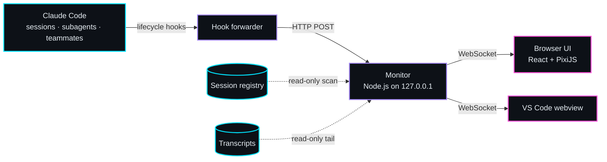

<!--
  Theme: futuristic neon · display type set in Archivo (rendered by readme-typing-svg, which embeds the font).
  Accents run cyan → indigo → violet → pink down the page:
    01 #00E5FF   02 #38BDF8   03 #818CF8   04 #A78BFA   05 #E879F9   06 #FF4FD8
  Interactive bits: section nav, back-to-top links, collapsible panels, hover tooltips,
  and a Mermaid diagram (GitHub renders it with zoom and pan controls).
  Never wrap a <picture> in a link: GitHub moves the  out of the picture and breaks light mode.
-->

<a id="top"></a>

<!-- ═══════════════════════════════ HERO ═══════════════════════════════ -->
<div align="center">


<picture>
  <source media="(prefers-color-scheme: dark)" srcset="https://readme-typing-svg.demolab.com?font=Archivo&weight=900&size=46&letterSpacing=-1px&duration=1400&color=E6EDF3&center=true&vCenter=true&repeat=false&width=760&height=80&lines=Hey%2C+I%27m+Jonathan+%F0%9F%91%8B" />
  <source media="(prefers-color-scheme: light)" srcset="https://readme-typing-svg.demolab.com?font=Archivo&weight=900&size=46&letterSpacing=-1px&duration=1400&color=0D1117&center=true&vCenter=true&repeat=false&width=760&height=80&lines=Hey%2C+I%27m+Jonathan+%F0%9F%91%8B" />
  
</picture>

<picture>
  <source media="(prefers-color-scheme: dark)" srcset="https://readme-typing-svg.demolab.com?font=Archivo&weight=600&size=13&letterSpacing=4px&duration=1&color=00E5FF&center=true&repeat=false&multiline=true&width=420&height=74&lines=FULL-STACK+DEVELOPER;OPEN-SOURCE+CREATOR;AI+%26+AUTOMATION+ENTHUSIAST" />
  <source media="(prefers-color-scheme: light)" srcset="https://readme-typing-svg.demolab.com?font=Archivo&weight=600&size=13&letterSpacing=4px&duration=1&color=0891B2&center=true&repeat=false&multiline=true&width=420&height=74&lines=FULL-STACK+DEVELOPER;OPEN-SOURCE+CREATOR;AI+%26+AUTOMATION+ENTHUSIAST" />
  
</picture>

<picture>
  <source media="(prefers-color-scheme: dark)" srcset="https://readme-typing-svg.demolab.com?font=Archivo&weight=600&size=21&duration=2600&pause=1000&color=FF4FD8&center=true&vCenter=true&width=620&height=44&lines=%3E+Building+Tools+Developers+Love;%3E+Full-Stack+Developer;%3E+Exploring+AI+%26+Automation;%3E+Open+Source+Enthusiast;%3E+Turning+Ideas+Into+Reality" />
  <source media="(prefers-color-scheme: light)" srcset="https://readme-typing-svg.demolab.com?font=Archivo&weight=600&size=21&duration=2600&pause=1000&color=DB2777&center=true&vCenter=true&width=620&height=44&lines=%3E+Building+Tools+Developers+Love;%3E+Full-Stack+Developer;%3E+Exploring+AI+%26+Automation;%3E+Open+Source+Enthusiast;%3E+Turning+Ideas+Into+Reality" />
  
</picture>

<br /><br />

<a href="#about" title="Jump to About Me"></a>
<a href="#stack" title="Jump to Tech Stack"></a>
<a href="#projects" title="Jump to Featured Projects"></a>
<a href="#stats" title="Jump to GitHub Stats"></a>
<a href="#activity" title="Jump to Developer Activity"></a>
<a href="#connect" title="Jump to Connect"></a>

</div>

<br />


<!-- ═══════════════════════════════ ABOUT ══════════════════════════════ -->

<h3 id="about"><picture>
  <source media="(prefers-color-scheme: dark)" srcset="https://readme-typing-svg.demolab.com?font=Archivo&weight=800&size=22&letterSpacing=3px&duration=1&color=00E5FF&vCenter=true&repeat=false&width=600&height=44&lines=01+%E2%80%94+ABOUT+ME" />
  <source media="(prefers-color-scheme: light)" srcset="https://readme-typing-svg.demolab.com?font=Archivo&weight=800&size=22&letterSpacing=3px&duration=1&color=0891B2&vCenter=true&repeat=false&width=600&height=44&lines=01+%E2%80%94+ABOUT+ME" />
  
</picture></h3>

I'm a full-stack developer with **3+ years** of experience building web applications end to end — from React, Next.js and Vue interfaces to Laravel and Node.js backends, the databases and queues behind them, and the Linux servers they run on.

I'm happiest deep in the backend: designing **REST APIs and services that scale**, wiring up payment gateways, webhooks and background workers, tracking down **performance** bottlenecks, and treating **security** as part of the design rather than an afterthought. Lately I've been building **AI-powered developer tools** and automation — from agent orchestration to computer vision and OCR — and publishing them as **open source**.

```yaml
role:        Full-Stack Developer
experience:  3+ years
backend:     [architecture, scalable APIs]
priorities:  [performance, security]
building:    AI developer tools + automation
open_source: true
```

<p align="right"><a href="#top" title="Back to top"><sub>↑ back to top</sub></a></p>


<!-- ═════════════════════════════ TECH STACK ═══════════════════════════ -->

<h3 id="stack"><picture>
  <source media="(prefers-color-scheme: dark)" srcset="https://readme-typing-svg.demolab.com?font=Archivo&weight=800&size=22&letterSpacing=3px&duration=1&color=38BDF8&vCenter=true&repeat=false&width=600&height=44&lines=02+%E2%80%94+TECH+STACK" />
  <source media="(prefers-color-scheme: light)" srcset="https://readme-typing-svg.demolab.com?font=Archivo&weight=800&size=22&letterSpacing=3px&duration=1&color=0284C7&vCenter=true&repeat=false&width=600&height=44&lines=02+%E2%80%94+TECH+STACK" />
  
</picture></h3>

<!-- Badge pattern: https://img.shields.io/badge/<Name>-161B22?style=flat-square&logo=<simple-icons-slug>&logoColor=<brand hex> -->
<table>
  <tr>
    <td><b>Languages</b></td>
    <td>
      
      
      
      
      
      
      
      
    </td>
  </tr>
  <tr>
    <td><b>Frontend</b></td>
    <td>
      
      
      
      
      
      
      
    </td>
  </tr>
  <tr>
    <td><b>Backend</b></td>
    <td>
      
      
      
      <br /><sub>RESTful APIs · Microservices · Webhooks</sub>
    </td>
  </tr>
  <tr>
    <td><b>Databases, ORM &amp; Caching</b></td>
    <td>
      
      
      
      
      
      
    </td>
  </tr>
  <tr>
    <td><b>Messaging &amp; Queues</b></td>
    <td>
      
      <br /><sub>Asynchronous job queues · Background workers · Cron jobs</sub>
    </td>
  </tr>
  <tr>
    <td><b>DevOps &amp; Cloud</b></td>
    <td>
      
      
      
      
      
      
      
      
      
      
      
      
      
    </td>
  </tr>
  <tr>
    <td><b>AI &amp; Automation</b></td>
    <td>
      
      
      
      
      <br /><sub>Python automation · AI agent orchestration · Workflow automation</sub>
    </td>
  </tr>
  <tr>
    <td><b>Mobile</b></td>
    <td>
      
      
    </td>
  </tr>
  <tr>
    <td><b>Payments &amp; Integrations</b></td>
    <td>
      
      
      
    </td>
  </tr>
</table>

<p align="right"><a href="#top" title="Back to top"><sub>↑ back to top</sub></a></p>


<!-- ══════════════════════════ FEATURED PROJECTS ═══════════════════════ -->

<h3 id="projects"><picture>
  <source media="(prefers-color-scheme: dark)" srcset="https://readme-typing-svg.demolab.com?font=Archivo&weight=800&size=22&letterSpacing=3px&duration=1&color=818CF8&vCenter=true&repeat=false&width=600&height=44&lines=03+%E2%80%94+FEATURED+PROJECTS" />
  <source media="(prefers-color-scheme: light)" srcset="https://readme-typing-svg.demolab.com?font=Archivo&weight=800&size=22&letterSpacing=3px&duration=1&color=4F46E5&vCenter=true&repeat=false&width=600&height=44&lines=03+%E2%80%94+FEATURED+PROJECTS" />
  
</picture></h3>

<table>
<tr>
<td>

<a href="https://github.com/JonathanClintonW/claude-office-agent" title="Open Claude Agent Office on GitHub">
  
</a>

<picture>
  <source media="(prefers-color-scheme: dark)" srcset="https://readme-typing-svg.demolab.com?font=Archivo&weight=800&size=28&letterSpacing=-0.5px&duration=1&color=E6EDF3&vCenter=true&repeat=false&width=500&height=48&lines=Claude+Agent+Office" />
  <source media="(prefers-color-scheme: light)" srcset="https://readme-typing-svg.demolab.com?font=Archivo&weight=800&size=28&letterSpacing=-0.5px&duration=1&color=0D1117&vCenter=true&repeat=false&width=500&height=48&lines=Claude+Agent+Office" />
  
</picture>

**A pixel-art office that brings Claude Code agents to life.**

A free, local-first visualizer for Claude Code. Every real session, subagent and agent-team teammate becomes an animated worker: desk monitors show the tool each agent is running, delegations fly between desks, and a built-in dashboard tracks tasks, errors, git status, token usage and session history.

- **Observe-only and local-first** — binds to `127.0.0.1`, redacts secrets, and never sends prompts, answers permission requests or calls a model
- **Zero extra Claude tokens, verified** — enforced by a static source scan, a runtime guard and a browser end-to-end test
- **One reducer everywhere** — the monitor, browser UI and VS Code webview share a single pure event reducer, so every view shows the same state
- **Full dashboard** — tasks, errors, git, analytics, history replay and team views, plus a VS Code extension

`TypeScript` `React` `PixiJS` `Vite` `Node.js` `WebSocket` `Vitest` `VS Code API`

<details>
<summary><b>See it in motion</b> · animated demo</summary>
<br />

</details>

<a href="https://github.com/JonathanClintonW/claude-office-agent" title="Star count on GitHub"></a>
<a href="https://github.com/JonathanClintonW/claude-office-agent/blob/master/LICENSE" title="Read the license"></a>
<a href="https://github.com/JonathanClintonW/claude-office-agent/commits/master" title="See the commit history"></a>

<sub>Independent open-source project — not affiliated with or endorsed by Anthropic.</sub>

</td>
</tr>
</table>

<details open>
<summary><b>How Claude Agent Office works</b> · click to collapse</summary>
<br />



</details>

<!--
  To add another project, copy the <table> block above and replace the
  repository name, screenshot, title, description, technologies and badge URLs.
-->

<p align="center">
  <a href="https://github.com/JonathanClintonW?tab=repositories" title="See every public repository"></a>
</p>

<p align="right"><a href="#top" title="Back to top"><sub>↑ back to top</sub></a></p>


<!-- ════════════════════════════ GITHUB STATS ══════════════════════════ -->

<h3 id="stats"><picture>
  <source media="(prefers-color-scheme: dark)" srcset="https://readme-typing-svg.demolab.com?font=Archivo&weight=800&size=22&letterSpacing=3px&duration=1&color=A78BFA&vCenter=true&repeat=false&width=600&height=44&lines=04+%E2%80%94+GITHUB+STATS" />
  <source media="(prefers-color-scheme: light)" srcset="https://readme-typing-svg.demolab.com?font=Archivo&weight=800&size=22&letterSpacing=3px&duration=1&color=7C3AED&vCenter=true&repeat=false&width=600&height=44&lines=04+%E2%80%94+GITHUB+STATS" />
  
</picture></h3>

<div align="center">


<sub>Contribution totals come from my full GitHub contribution calendar · the language breakdown covers public repositories only</sub>

</div>

<p align="right"><a href="#top" title="Back to top"><sub>↑ back to top</sub></a></p>


<!-- ═════════════════════════ DEVELOPER ACTIVITY ═══════════════════════ -->

<h3 id="activity"><picture>
  <source media="(prefers-color-scheme: dark)" srcset="https://readme-typing-svg.demolab.com?font=Archivo&weight=800&size=22&letterSpacing=3px&duration=1&color=E879F9&vCenter=true&repeat=false&width=600&height=44&lines=05+%E2%80%94+DEVELOPER+ACTIVITY" />
  <source media="(prefers-color-scheme: light)" srcset="https://readme-typing-svg.demolab.com?font=Archivo&weight=800&size=22&letterSpacing=3px&duration=1&color=C026D3&vCenter=true&repeat=false&width=600&height=44&lines=05+%E2%80%94+DEVELOPER+ACTIVITY" />
  
</picture></h3>

<div align="center">


<sub>Updated automatically from my GitHub contribution calendar</sub>

<!--
  CONTRIBUTION SNAKE (disabled until its workflow exists)
  1. Add .github/workflows/snake.yml to this repository (see setup notes).
  2. Run the workflow once from the Actions tab so the "output" branch is created.
  3. Delete this comment's opening and closing markers to show the animation.

<br /><br />
<picture>
  <source media="(prefers-color-scheme: dark)" srcset="https://raw.githubusercontent.com/JonathanClintonW/JonathanClintonW/output/snake-dark.svg" />
  <source media="(prefers-color-scheme: light)" srcset="https://raw.githubusercontent.com/JonathanClintonW/JonathanClintonW/output/snake-light.svg" />
  
</picture>
-->

</div>

<p align="right"><a href="#top" title="Back to top"><sub>↑ back to top</sub></a></p>


<!-- ══════════════════════════════ CONNECT ═════════════════════════════ -->

<h3 id="connect"><picture>
  <source media="(prefers-color-scheme: dark)" srcset="https://readme-typing-svg.demolab.com?font=Archivo&weight=800&size=22&letterSpacing=3px&duration=1&color=FF4FD8&vCenter=true&repeat=false&width=600&height=44&lines=06+%E2%80%94+CONNECT" />
  <source media="(prefers-color-scheme: light)" srcset="https://readme-typing-svg.demolab.com?font=Archivo&weight=800&size=22&letterSpacing=3px&duration=1&color=DB2777&vCenter=true&repeat=false&width=600&height=44&lines=06+%E2%80%94+CONNECT" />
  
</picture></h3>

<div align="center">

Have a question about one of my projects, or an idea worth building?<br />
Open an issue on the relevant repository or follow my work here on GitHub.

<br />

<a href="https://github.com/JonathanClintonW" title="Follow me on GitHub"></a>
<a href="https://github.com/JonathanClintonW/claude-office-agent" title="Star Claude Agent Office"></a>
<!-- Add verified links here, e.g. LinkedIn, email or portfolio, using the same badge style. -->

<br /><br />

<picture>
  <source media="(prefers-color-scheme: dark)" srcset="https://readme-typing-svg.demolab.com?font=Archivo&weight=700&size=18&duration=1600&color=A78BFA&center=true&vCenter=true&repeat=false&width=620&height=40&lines=Thanks+for+stopping+by+%E2%80%94+let%27s+build+something+useful." />
  <source media="(prefers-color-scheme: light)" srcset="https://readme-typing-svg.demolab.com?font=Archivo&weight=700&size=18&duration=1600&color=7C3AED&center=true&vCenter=true&repeat=false&width=620&height=40&lines=Thanks+for+stopping+by+%E2%80%94+let%27s+build+something+useful." />
  
</picture>

<p align="right"><a href="#top" title="Back to top"><sub>↑ back to top</sub></a></p>

</div>


